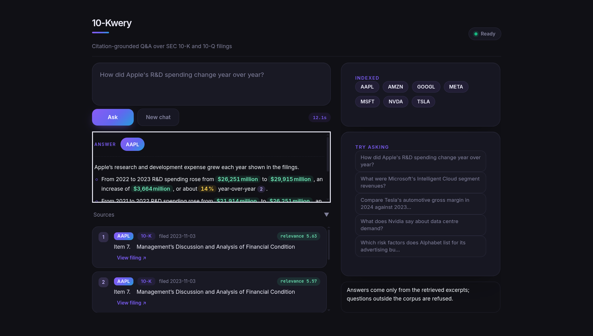

# 10-Kwery

10-Kwery is a Retrieval-Augmented Generation (RAG) system for querying SEC filings (10-K and 10-Q) using natural language. It downloads filings from the SEC EDGAR database, processes and indexes them into a hybrid retrieval system, and generates citation-grounded answers using a Large Language Model (LLM).

The project demonstrates an end-to-end financial document retrieval pipeline consisting of data ingestion, table-aware preprocessing, indexing, four-channel hybrid retrieval, type-balanced reranking, answer generation, and evaluation.



## Features

- Download SEC 10-K / 10-Q filings from EDGAR
- HTML parsing and section-aware document chunking
- Table extraction: tables are kept intact as dedicated typed chunks with rule-based natural-language summaries
- Token-based chunking with overlap using **tiktoken**
- Dense semantic retrieval with **BAAI/bge-small-en-v1.5**
- Keyword retrieval using **BM25** (rank_bm25)
- Four-channel hybrid retrieval: dense + BM25 over all chunks, plus dense + BM25 over *tables only*, fused via **Reciprocal Rank Fusion (RRF)**
- Automatic 10-K / 10-Q form detection and metadata pre-filtering
- Windowed cross-encoder reranking with **cross-encoder/ms-marco-MiniLM-L-6-v2**
- Type-balanced final selection so relevant tables are not crowded out by prose
- Refusal handling for out-of-corpus companies and low-relevance matches
- Citation-grounded answer generation using **Groq**
- Answer caching to avoid redundant LLM calls during evaluation
- Rate limiting and retry with exponential backoff for the Groq free tier
- Web interface: Gradio UI plus a FastAPI JSON API, served from one process
- Streaming progress (spinner, stage bar, elapsed time) with a measured latency estimate
- Per-client rate limiting and bounded concurrency for the shared free LLM key
- Evaluation using **MRR**, **Hit@1**, **Hit@5**, ticker precision, rank disagreement, citation validity, and keyword coverage


# Project Structure

```text
10Kwery/
├── app.py                     # web server (Gradio UI + FastAPI JSON API)
├── requirements.txt
├── data/
│   ├── filings/          # raw EDGAR HTML + metadata sidecars
│   ├── chunks/           # chunks.jsonl
│   ├── chroma_db/        # ChromaDB vector index
│   └── bm25_index.pkl    # BM25 keyword index
├── src/
│   ├── config.py         # env-driven paths + logging setup
│   ├── service.py        # web service layer (warm-up, concurrency, results)
│   ├── ingestion.py
│   ├── chunk.py
│   ├── index.py
│   ├── retrieve.py
│   ├── generate.py
│   ├── evaluate.py
│   ├── entailment.py
│   ├── query_rewrite.py
│   ├── router.py
│   └── session.py
├── deploy/
│   ├── space_README.md   # Space landing page (carries YAML frontmatter)
│   ├── prepare_dataset.py# stage + upload the retrieval index
│   ├── push_space.py     # create the Space and deploy
│   └── keepalive.yml     # cron that pings /health
└── eval/
    └── qa_pairs.json     # 60 questions (18 dev + 42 heldout)
```


# Architecture

```
SEC EDGAR
    │
    ▼
Download Filings
    │
    ▼
HTML Parsing + Table Extraction
    │
    ▼
Section-aware Chunking (+ table summaries)
    │
    ▼
Embedding Generation
    │
    ▼
ChromaDB Index + BM25 Index
    │
    │
User Query
    │
    ▼
Form Filter Detection (10-K / 10-Q)
    │
    ├────────────┬────────────────┬────────────────┐
    ▼            ▼                ▼                ▼
Vector Search  BM25 Search    Vector Search   BM25 Search
(all chunks)   (all chunks)   (tables only)   (tables only)
    │            │                │                │
    └────────────┴───────┬────────┴────────────────┘
                          ▼
           Reciprocal Rank Fusion (k = 60)
                          │
                          ▼
      Cross-Encoder Reranking (windowed, best-window score)
                          │
                          ▼
       Type-Balanced Final Selection (table slot reservation)
                          │
                          ▼
                     Groq LLM
                          │
                          ▼
           Citation-grounded Answer
```


# Models

| Component | Model |
|----------|-------|
| Embedding | **BAAI/bge-small-en-v1.5** |
| Reranker | **cross-encoder/ms-marco-MiniLM-L-6-v2** |
| LLM | **openai/gpt-oss-120b (Groq)** |


# Technologies

- Python
- BeautifulSoup / lxml
- tiktoken
- ChromaDB
- Sentence Transformers (bi-encoder + CrossEncoder)
- rank_bm25
- Groq API
- FastAPI + Gradio (web UI and JSON API)
- uvicorn
- NumPy
- Requests
- tqdm


# Installation

Clone the repository.

```bash
git clone https://github.com/<username>/10Kwery.git
cd 10Kwery
```

Install dependencies.

```bash
pip install -r requirements.txt
```

Create a `.env` file in the project root.

```env
GROQ_API_KEY=your_groq_api_key
SEC_USER_AGENT=Your Name your.email@example.com
```

`SEC_USER_AGENT` is required by the SEC EDGAR API and should identify you with your name and email address.

Example:

```env
GROQ_API_KEY=gsk_xxxxxxxxxxxxxxxxxxxxxxxxxxxxxxxxx
SEC_USER_AGENT=John Doe john.doe@example.com
```


# Usage

### 1. Download SEC filings

```bash
python src/ingestion.py
```

### 2. Chunk the filings

```bash
python src/chunk.py
```

This rewrites `data/chunks/chunks.jsonl` from scratch on every run.

### 3. Build the retrieval index

```bash
python src/index.py --force
```

This step:

- Generates embeddings using **BAAI/bge-small-en-v1.5** (tables embed their natural-language summary; prose embeds its text)
- Builds a **ChromaDB** vector database (cosine space)
- Builds a **BM25** keyword index (chunk text + summary)

> **Always pass `--force` after re-chunking.** Without it, existing chunk IDs are
> skipped rather than re-embedded, which silently leaves stale embeddings behind.

### 4. Query the system

**Web interface** (Gradio UI plus a JSON API on one server):

```bash
python app.py          # http://localhost:7860
```

While a query runs, the answer panel streams a spinner, a per-stage progress
bar and a running elapsed counter, alongside an estimate taken from the median
of the last dozen queries — a retrieval takes 10–17 s, so the panel would
otherwise look frozen on the previous answer.

**Command line:**

```bash
python src/generate.py "How did Apple's R&D spending change year over year?"
```

Example output:

```text
ANSWER
------------------------------------------------------------
Apple's research and development expense increased from ...
[1][2]

SOURCES
------------------------------------------------------------
[1] AAPL 10-K filed 2024-11-01
[2] AAPL 10-K filed 2023-11-03
```

Questions about companies outside the indexed corpus trigger an explicit refusal instead of a hallucinated answer.

**Streaming** is available:

```bash
python src/generate.py "Your question?" --stream
```

**Multi-turn** mode:

```bash
python src/generate.py --chat
```

**Disable caching** (force fresh Groq calls every time):

```bash
python src/generate.py "Your question?" --no-cache
```

**Clear the answer cache**:

```bash
python src/generate.py --clear-cache
```

Additional flags: `--no-rewrite` (skip query rewriting), `--no-router` (skip company routing), `--verify` (citation entailment check), `--llm-judge` (LLM-based entailment), `--legacy-rerank` (use legacy reranker mode).

### 5. Evaluate retrieval performance

```bash
python src/evaluate.py
```

Run on a specific split:

```bash
python src/evaluate.py --split dev
python src/evaluate.py --split heldout
```

Skip generation (retrieval-only):

```bash
python src/evaluate.py --no-llm
```

The evaluation compares:

- Vector-only retrieval (dense top-5 baseline)
- Hybrid retrieval (four-channel RRF + windowed rerank + balanced selection)

Metrics reported include:

- Mean Reciprocal Rank (MRR)
- Hit@1
- Hit@5
- Per-question rank disagreement between the two configs
- Expected-ticker precision of retrieved context
- Citation Validity
- Expected Keyword Coverage
- Groq API calls and cache hit counts

Answers are cached in `eval/answers_cache.json` so re-running the eval does not repeat Groq calls for the same questions. On subsequent runs, expect **0 API calls**.


# Retrieval Pipeline

1. Detect an optional form filter (`10-K` / `10-Q`) from the query text
2. Encode the user query using **bge-small-en-v1.5** with the bge query instruction prefix
3. Retrieve candidates from four channels:
   - dense vector search over all chunks (k = 75)
   - BM25 keyword search over all chunks (k = 75)
   - dense vector search over **tables only** (k = 15)
   - BM25 keyword search over **tables only** (k = 15)
4. Fuse all four rankings with **Reciprocal Rank Fusion** (k = 60) into a candidate pool (~165 chunks)
5. Rerank the pool with **ms-marco-MiniLM-L-6-v2**: long chunks are scored in overlapping 1200-character windows (200-character overlap); each chunk keeps its best-window score
6. Apply **type-balanced final selection**:
   - at most 2 table slots in the final five
   - if no table qualifies on absolute score, the single best table is still seated when it lies within 4.0 points of the best selected chunk — tables compete against tables instead of being drowned out by prose
7. Refusal guard: decline to answer when the question names unindexed companies or when no excerpt clears the relevance floor
8. Pass the selected excerpts (with source labels and table overviews) to the LLM
9. Generate a citation-grounded response


# Chunking Pipeline

- Filings are parsed with **lxml**; scripts, styles, hidden elements and inline XBRL wrappers are stripped
- `<table>` elements are replaced by unique placeholders, then restored as standalone typed chunks (kept whole, never split)
- Tables shorter than 15 tokens are demoted to plain text
- Item-level headers (e.g. `ITEM 7.`) reset the active section, which is stored as chunk metadata
- Prose is chunked at 600 tokens with 80 tokens of overlap
- Every table chunk receives a rule-based natural-language summary used for embedding and generation context:
  - the preceding lead-in sentence comes first ("The following table shows net sales by category…")
  - column headers, row line items, and notable values follow
  - company identity is compressed to a short `{company} {form} data table` tag so shared boilerplate does not drown the distinguishing tokens in embedding space


# Evaluation Metrics

| Metric | Description |
|---------|-------------|
| MRR | Mean reciprocal rank of the first chunk from an expected company. |
| Hit@1 | Percentage of queries where the correct company is ranked first. |
| Hit@5 | Percentage of queries where the correct company appears within the top five results. |
| Rank disagreement | Questions where baseline and hybrid produce different first-hit ranks. |
| Citation Validity | Verifies that generated citations correspond to retrieved chunks. |
| Keyword Coverage | Measures how well generated answers cover the expected concepts. |

Latest results on the 60-question eval set (18 dev + 42 heldout):

```text
MRR — vector-only baseline:   0.900
MRR — hybrid + rerank:        0.933
Hit@1 — baseline / hybrid:    54/60 (90%)  vs  56/60 (93%)
Hit@5 — baseline / hybrid:    54/60 (90%)  vs  56/60 (93%)
Rank disagreements b/h:       2/60
Citation validity rate:       60/60 (100%)
Avg. expected-keyword coverage: 85%
Avg. hybrid retrieval latency:    16.88s
```

The hybrid retrieval with table-aware reranking outperforms the vector-only baseline by ~3% across all metrics. All generated citations are valid (100% citation validity rate).


# Groq Free Tier Notes

The free Groq tier has a tight rate limit (~30 RPM). To avoid timeouts:

- **Answer caching**: `eval/answers_cache.json` stores answers keyed by query + chunks. Re-running `evaluate.py` hits the cache for previously answered questions (0 API calls on subsequent runs).
- **Rate limiting**: A configurable delay (`GROQ_REQUEST_DELAY`, default 2.5s) separates API calls.
- **Retry logic**: Up to 3 retries with exponential backoff on rate-limit errors.
- **Skip generation**: Use `--no-llm` to evaluate retrieval quality without hitting the API.
- **Disable rewriting/router**: Use `--no-rewrite --no-router` to halve the number of Groq calls per question.


# Future Improvements

- Optional two-stage reranking: a stronger cross-encoder arbitrating a MiniLM-shortlisted set
- Additional SEC filing types (8-K)
- Batch evaluation with parallel API calls for faster large-scale runs


# Deployment

The project ships with a web front end (`app.py`): a Gradio UI at `/`, a JSON
API at `/api/*`, and a `/health` probe. It runs locally with `python app.py` and
on any host that can run a Python process — see [Running the server
locally](#running-the-server-locally) below.

## Hosting options

The pipeline needs PyTorch, ChromaDB and two transformer models, and I measured
it at **1.32 GB peak RSS**, which rules out every free tier below roughly 1.5 GB.

| Host | Free resources | Verdict |
|------|----------------|---------|
| Hugging Face Spaces PRO | $9/mo, CPU Basic (2 vCPU / 16 GB) | Least work; the Space scripts below work unchanged |
| Hugging Face Spaces (free account) | 2 ZeroGPU Spaces | **Cannot host this app** — see the note below |
| Oracle Cloud Always Free | $0 forever, 2 OCPU / 12 GB RAM, card required | Genuinely free; needs a `Dockerfile` |
| Google Cloud Run | ~$0 at low traffic, card required | Scales to zero when idle |
| Streamlit Community Cloud | 1 GB RAM | Would OOM |
| Koyeb free / Render / Fly.io | ≤ 512 MB or paid | Not enough RAM |

> **Note on HF Spaces.** A paid plan is now required to create any Space that runs
> compute (Gradio or Docker); only Static Spaces are free to create, and free
> personal accounts may host up to 2 Gradio Spaces on ZeroGPU. CPU Basic itself
> still has no hourly cost, but a free account cannot create a Space on it. These
> scripts are unaffected — `app.py` is host-agnostic — but there is no longer a
> free, no-credit-card path through Spaces. On the $9/mo PRO route the two
> scripts below work exactly as written.

## Why the index is a dataset

Whatever the host, a Space's 50 GB runtime disk is **ephemeral** — wiped on every
restart — so the index cannot live in the container image. It is published as a
dataset and downloaded on boot. Locally this is a no-op: `src/config.py` resolves
the index from `data/`, and `DATA_DIR` can point anywhere.

## Publishing the index and deploying to a Space

```bash
# 1. Build the index locally (add tickers in src/ingestion.py to widen the corpus)
python src/ingestion.py
python src/chunk.py
python src/index.py --force

# 2. Publish the index as a dataset (277 MB; the raw filings are excluded)
HF_TOKEN=hf_... python deploy/prepare_dataset.py --repo-id you/10kwery-index

# 3. Create the Space and push the app
HF_TOKEN=hf_... python deploy/push_space.py --space-id you/10kwery
```

Then set these under the Space's **Settings > Variables and secrets** page and
restart it:

| Name | Value | Why |
|------|-------|-----|
| `GROQ_API_KEY` | `gsk_...` | **Secret.** LLM access. Never passed through a script. |
| `INDEX_DATASET` | `you/10kwery-index` | **Variable.** Where to fetch the index. |
| `HF_TOKEN` | `hf_...` | Optional; only needed if the dataset is private. |
| `ENABLE_FOLLOWUP_CONDENSE` | `0` | Optional; its result is only logged, so it is safe to skip. |
| `MAX_CONCURRENT_REQUESTS` | `2` | Optional; matches the 2 available cores. |
| `RATE_LIMIT_RPM` | `10` | Optional; per-client request budget. |

The first boot downloads the index and loads both models, so allow 2–3 minutes
before the first query.

## Keeping it awake

A Space sleeps after 48 hours without visitors and wakes with an empty disk,
forcing an index re-download. `deploy/keepalive.yml` is a cron workflow that
pings the health endpoint every 40 hours. Copy it to `.github/workflows/` and set
the `SPACE_URL` repository variable.

## Endpoints

| Endpoint | Purpose |
|----------|---------|
| `/` | Gradio UI |
| `GET /health` | Readiness probe (`ready`, `load_error`) |
| `GET /api/companies` | Indexed tickers |
| `POST /api/query` | `{"question", "history":[]}` → answer + sources |

```bash
curl -X POST http://localhost:7860/api/query \
  -H 'Content-Type: application/json' \
  -d '{"question":"What drove Tesla automotive revenue growth in 2024?"}'
```

Supplying `history` with per-turn `tickers` is what makes a pronoun follow-up
("how did that change?") resolve to the right company: the routed ticker is
carried through the rule-based rewrite that scopes the retrieval query.

## Running the server locally

```bash
source venv/bin/activate
python app.py          # http://localhost:7860
```

Locally there is nothing to configure — the index resolves from `data/` and the
answer cache from `eval/`. The CLI keeps working unchanged:
`python src/generate.py "..."`.

## Deployment-specific behaviour

Because the free tier is shared and small, the web defaults differ from the CLI:

- **Query rewriting and LLM routing use the same defaults as the CLI.**
  The rule-based router resolves the seven indexed tickers for free and only
  calls the LLM when no alias matches, so most questions still cost one Groq
  call. Set `ENABLE_FOLLOWUP_CONDENSE=0` to skip the extra condense call per
  follow-up turn (its result is only logged, so nothing breaks).
- **Requests are bounded two at a time** and rate limited per client. The Groq
  free tier is ~30 RPM and a single query takes ~17 s on 2 cores, so the
  semaphore is the real throttle.
- **Pipelines logs go through `logging`**, not `print`, so concurrent requests
  do not interleave output.
- **The answer cache is disposable.** It lives under `CACHE_DIR` (defaults to
  `eval/`) and resets with the container.


# License

This project is intended for educational and research purposes.
